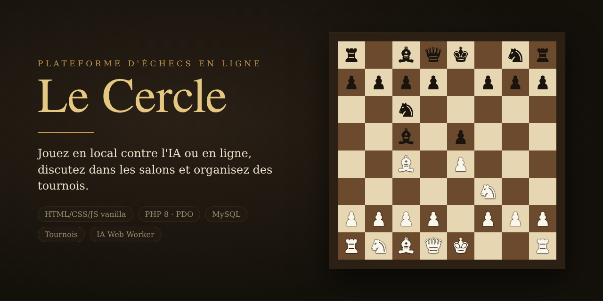

<h1 align="center">
  
</h1>

<p align="center">
  <a href="https://github.com/bhrochdi/chess/actions/workflows/ci.yml"></a>
  <a href="https://github.com/bhrochdi/chess/releases/latest"></a>
  <a href="https://github.com/bhrochdi/chess/releases"></a>
  
  
  
  
  
  <a href="docs/README.md"></a>
</p>

<p align="center">
  <a href="#télécharger">Télécharger</a> ·
  <a href="#installation">Installation</a> ·
  <a href="docs/README.md">Documentation</a> ·
  <a href="https://github.com/bhrochdi/chess/releases">Versions</a>
</p>

Le Cercle est le site d'un club d'échecs. On y joue contre l'ordinateur, à deux
sur un même écran ou en ligne, on discute dans des salons ou en privé, on suit
et on dispute des tournois, et un administrateur modère le tout. Il tourne sur
un hébergement PHP/MySQL ordinaire (WampServer, Apache ou Docker), sans service
externe.

Le serveur décide de tout : coups légaux, pendule, résultats, appariements et
droits d'administration sont calculés en PHP. Le navigateur affiche l'état reçu
et envoie les actions du joueur ; modifier le JavaScript de sa page ne permet
pas de tricher.

## Ce qu'il fait

- **Jeu local** contre l'ordinateur (débutant, club, maître) ou à deux sur un
  écran, avec pendule, annulation de coup, échiquier retournable et export PGN.
  La partie reprend après un rechargement.
- **Parties en ligne** : défis ouverts, pendule tenue par le serveur, nulle,
  abandon, spectateurs et commentaires en direct sous la partie.
- **Discussions** : salons thématiques avec badge de non-lus, messages privés.
- **Tournois** toutes rondes, élimination directe ou système suisse. Chaque
  rencontre est une partie en ligne, et son résultat s'inscrit au classement
  dès la fin de la partie.
- **Comptes** : inscription, connexion par pseudo ou e-mail, accès invité en un
  clic, joueurs en ligne, statistiques calculées à partir des parties.
- **Administration** : comptes (suspension, rôles, suppression), salons,
  parties, tournois, purges, et un journal de chaque action.
- Interface en français, quatre thèmes (bois, clair, marbre, nocturne).

Le rôle de chaque fonction et les règles que le serveur garantit sont décrits
cas par cas dans [docs/architecture/cas-d-utilisation.md](docs/architecture/cas-d-utilisation.md).

## Télécharger

Chaque version publiée est sur la page des
[versions](https://github.com/bhrochdi/chess/releases), avec l'archive des
sources ; la dernière est
[ici](https://github.com/bhrochdi/chess/releases/latest). Chaque pull request
fusionnée dans `main` publie une version : son étiquette `semver:major`,
`semver:minor` ou `semver:patch` choisit le numéro (`patch` sans étiquette), et
`semver:none` n'en publie pas. Pour la
version en cours de développement, cloner le dépôt :

```
git clone https://github.com/bhrochdi/chess.git
```

## Installation

### Docker

PHP 8.3, Apache et MySQL 8.0 dans deux conteneurs :

```
cp .env.example .env                              # puis adapter les identifiants
cp api/config.docker.example.php api/config.php
docker compose up -d --build
docker compose run --rm --user "$(id -u):$(id -g)" -e COMPOSER_HOME=/tmp/composer web composer install
docker compose run --rm web php bin/migrate.php
```

Ouvrir `http://localhost:8080/`. Le premier compte inscrit devient
administrateur.

Un volume MySQL créé par une ancienne version n'a pas la base des tests
d'intégration ; la créer une fois :

```
docker compose exec db sh /docker-entrypoint-initdb.d/02-test-database.sh
```

### WampServer

1. Créer la base :
   ```
   c:/wamp64/bin/mysql/<version>/bin/mysql.exe -u root -p -e "CREATE DATABASE IF NOT EXISTS le_cercle CHARACTER SET utf8mb4 COLLATE utf8mb4_unicode_ci"
   ```
2. Configuration :
   ```
   copy api\config.example.php api\config.php   # puis adapter les identifiants
   ```
3. Dépendances et tables :
   ```
   composer install --no-dev
   php bin/migrate.php        # « Appliquée : … » puis, aux appels suivants, « Base à jour. »
   ```
4. Hôte virtuel Apache (menu WampServer → Apache → `httpd-vhosts.conf`) : la
   racine web est `public/` et `api/` est servi sous `/api`. Rien d'autre du
   dépôt (`src/`, `vendor/`, `sql/`…) n'est accessible.
   ```
   <VirtualHost *:80>
       ServerName le-cercle.localhost
       DocumentRoot "c:/wamp64/www/le-cercle/public"
       Alias /api "c:/wamp64/www/le-cercle/api"
       <Directory "c:/wamp64/www/le-cercle/public">
           Options -Indexes
           Require all granted
       </Directory>
       <Directory "c:/wamp64/www/le-cercle/api">
           Options -Indexes
           AllowOverride All
           Require all granted
       </Directory>
   </VirtualHost>
   ```
   Redémarrer Apache, puis ouvrir `http://le-cercle.localhost/`.

Une mise à jour se limite à récupérer le code puis relancer
`php bin/migrate.php`.

## Structure du projet

```
public/                   racine web : index.html, css/, js/ (affichage seulement)
  js/core/                noyau partagé : client d'API, échiquier, lecture FEN, compte, présence
  js/views/               une vue par fichier : accueil, jeu local, partie en ligne, salon,
                          messages, tournois, administration
api/                      points d'entrée PHP, servis sous /api : auth, games, rooms,
                          direct-messages, game-comments, tournaments, admin, health
src/
  Chess/                  domaine d'échecs en PHP pur : règles, SAN, fin de partie, IA
  Game/                   parties : coups, pendule, ordinateur, nulle, PGN
  Chat/                   salons, messages privés, commentaires de partie
  Tournament/             appariements, classements, cycle de vie d'un tournoi
  User/                   comptes, connexion, invités, présence
  Admin/                  journal et tableau de bord
  Shared/                 ports communs : horloge, session, transactions, exceptions
  Infra/                  PDO, HTTP, session PHP, horloge système, liens entre modules
sql/migrations/           migrations numérotées, seule source du schéma
bin/migrate.php           applique les migrations
tests/                    Unit/, Integration/, http/, front/
docker/                   image PHP/Apache, hôte Apache, pile du test de fumée
docs/                     architecture, plan de test manuel, bannière
```

## Tests

Le PHP se teste dans Docker, depuis la racine du dépôt :

```
D="docker compose run --rm --no-deps --user $(id -u):$(id -g) -e COMPOSER_HOME=/tmp/composer web"
$D composer install          # une seule fois, sur un clone neuf
$D composer test             # tests unitaires PHPUnit
$D composer test:slow        # IA niveau maître
$D composer test:coverage    # rapport HTML dans build/coverage
$D composer lint             # PHP-CS-Fixer (PER-CS 2.0) puis PHPStan niveau 8

DI="docker compose run --rm --user $(id -u):$(id -g) -e COMPOSER_HOME=/tmp/composer web"
$DI composer test:integration   # contre MySQL, base le_cercle_test

tests/http/smoke.sh http://localhost:8080   # contrôle HTTP de l'application démarrée
node tests/front/unit/run.mjs               # calculs du front
tests/front/smoke.sh                        # test de fumée navigateur (Playwright, pile Docker dédiée)
```

La CI GitHub Actions lance les mêmes contrôles en quatre tâches (`lint`,
`test`, `front`, `integration`), construites comme cibles de
`docker/php/Dockerfile` :

```
docker build -f docker/php/Dockerfile --target lint .
docker build -f docker/php/Dockerfile --target test .
docker build -f docker/php/Dockerfile --target jstest .
docker build -f docker/php/Dockerfile --target jscheck .
```

Ce que les tests automatiques ne couvrent pas se vérifie à la main avec
[docs/TESTS-MANUELS.md](docs/TESTS-MANUELS.md).

## Documentation

L'index complet est dans [docs/README.md](docs/README.md).

| Document | Pour |
|---|---|
| [Architecture](docs/architecture/README.md) | cas d'utilisation, organisation du code, API et règles de chaque module |
| [Plan de test manuel](docs/TESTS-MANUELS.md) | vérifier l'application servie avant une livraison |
| [Contribuer](CONTRIBUTING.md) | signaler un bug, proposer une modification, conventions |

## Contribuer

Les tickets et les pull requests sont bienvenus ; lire d'abord
[CONTRIBUTING.md](CONTRIBUTING.md). Les problèmes de sécurité passent par
[SECURITY.md](SECURITY.md), pas par un ticket public. Chacun suit le
[code de conduite](CODE_OF_CONDUCT.md).

En bref : commentaires, commits et documentation en français, identifiants en
anglais ; Conventional Commits ; requêtes préparées partout ; identifiants
jamais versionnés (`api/config.php`, `.env`) ; pas de modification du moteur
(`src/Chess/`) sans tests de non-régression, perft compris.

## Licence

Le dépôt n'a pas encore de licence ; le choix revient à son propriétaire.
