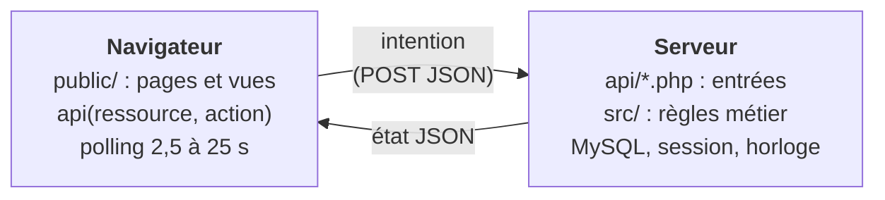

# Architecture de Le Cercle

Ces pages décrivent ce que fait la plateforme, pour qui, et comment le code
est organisé pour le faire. Elles s'adressent à qui veut construire, modifier
ou relire Le Cercle. L'installation et les commandes sont dans le [README](../../README.md),
les vérifications à la main dans [TESTS-MANUELS.md](../TESTS-MANUELS.md).

## Vue d'ensemble

Le Cercle est le site d'un club d'échecs : on y joue (seul contre l'ordinateur,
à deux sur un même écran, ou en ligne), on y discute, on y suit des tournois, et
un administrateur y tient l'ordre. Il tourne sur un hébergement PHP/MySQL
ordinaire (WampServer, Apache mutualisé ou Docker), sans service externe.

Un principe guide tout le reste : **le serveur décide, le navigateur affiche.**
Le navigateur envoie des intentions (« jouer e2e4 », « abandonner », « envoyer
ce message ») et dessine l'état que le serveur lui renvoie. Les règles du jeu,
la pendule, les résultats, les appariements de tournoi et les droits
d'administration n'existent qu'en PHP. Un joueur qui modifie le JavaScript de sa
page ne peut donc ni jouer un coup illégal, ni arrêter sa pendule, ni se
déclarer vainqueur, ni s'accorder des droits.

## Acteurs

| Acteur | Qui | Ce qui le distingue |
|--------|-----|---------------------|
| Visiteur | personne non connectée | lit l'état public : parties en cours, salons, tournois, joueurs en ligne |
| Invité | compte créé d'un clic, sans e-mail ni mot de passe (`Invite_` + 8 caractères) | joue et discute ; ne s'inscrit pas aux tournois ; ne peut pas se reconnecter après une déconnexion |
| Joueur inscrit | compte avec pseudo, e-mail et mot de passe | tout ce que fait l'invité, plus les tournois et des statistiques durables |
| Administrateur | joueur inscrit au rôle `admin` ; le premier compte inscrit le devient | modère les comptes, salons et parties, pilote les tournois, lit le journal |

Pourquoi un invité est un vrai compte : toutes les parties, même locales, sont
tenues par le serveur. Il faut donc une identité serveur à qui rattacher la
partie, la reprendre après un rechargement et refuser les coups d'un autre
navigateur. Un compte invité donne cette identité sans imposer d'inscription.

## Sommaire

1. [Cas d'utilisation](cas-d-utilisation.md) : UC1 à UC10, pourquoi chaque fonction existe et ce que le serveur garantit.
2. [Organisation du code](organisation-du-code.md) : dossiers, règles de dépendance, navigateur, polling.

Modules serveur (classes, états, API, tables et règles) :

3. [Domaine échecs](echecs.md) : position, coups légaux, fin de partie, IA et ses performances.
4. [Infrastructure et contrats d'API](infrastructure.md) : ports communs, HTTP, migrations, règles communes à toutes les API.
5. [Parties](parties.md) : états, pendule, `api/games.php`, stockage.
6. [Discussions](discussions.md) : salons, messages privés, commentaires.
7. [Utilisateurs](utilisateurs.md) : comptes, invités, présence, limitation des connexions.
8. [Tournois](tournois.md) : appariements, classement, états, `api/tournaments.php`.
9. [Administration](administration.md) : journal et tableau de bord.
10. [Sécurité et tests](securite-et-tests.md) : menaces et réponses, niveaux de test, CI.

## Hors périmètre

- WebSockets : le polling suffit au rythme d'une partie et fonctionne sur tout
  hébergement PHP.
- IA forte (Stockfish) : possible plus tard derrière la même interface
  `MoveChooser`.
- Connexion par Google ou un autre fournisseur (OAuth).
- Chiffrement des messages privés.

## Historique

Le Cercle est né d'un prototype d'une seule page HTML : toutes les règles
s'exécutaient dans le navigateur, et PHP n'offrait qu'un stockage clé-valeur
(`api/storage.php`, table `kv_store`) où chacun pouvait écrire sans être
connecté. La migration de novembre 2026 a porté le moteur d'échecs et l'IA en
PHP, puis chaque fonction (parties, discussions, tournois, comptes,
administration) dans son module serveur, a réduit le navigateur à l'affichage
et a supprimé l'ancien stockage. L'historique Git garde le détail de chaque
étape.

---

[Cas d'utilisation](cas-d-utilisation.md) →
