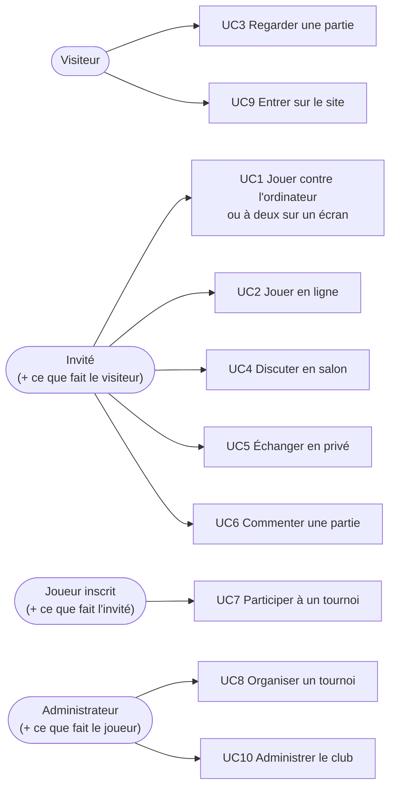

# Cas d'utilisation

[Architecture](README.md) › Cas d'utilisation

Chaque cas indique pourquoi la fonction existe, ce que le serveur garantit, et
le code qui la porte.

## UC1 — Jouer contre l'ordinateur ou à deux sur un écran

**Acteur :** invité ou joueur inscrit. **Vue :** « Jeu local & IA ».

Le joueur choisit un adversaire (deux joueurs sur le même écran, ou l'ordinateur
en niveau débutant, club ou maître) et une cadence (sans pendule, 3 min + 2 s,
5, 10 ou 15 min + 10 s), puis joue. Il peut annuler son dernier coup, retourner
l'échiquier et exporter la partie en PGN. En rouvrant la vue, même après un
rechargement, il retrouve la partie en cours.

**Pourquoi :** c'est l'entraînement sans adversaire disponible, et la porte
d'entrée du site. Le faire passer par le même `GameService` que les parties en
ligne évite deux moteurs de règles qui divergent.

**Garanties du serveur :** seuls les coups légaux passent (roque, prise en
passant, promotion compris) ; la fin de partie (mat, pat, 50 coups, triple
répétition, matériel insuffisant, temps) est constatée par le serveur ;
l'annulation est réservée aux parties locales, et contre l'ordinateur elle
retire aussi sa réponse. L'ordinateur joue dans la même requête que le coup du
joueur ; le niveau maître reste sous 10 s par coup.

**Code :** `src/Game/` (`GameService`, `Game`, `ComputerPlayers`), `src/Chess/`
(règles, IA), `api/games.php` ; `public/js/views/local.js`.

**Détail :** [Parties](parties.md).

## UC2 — Jouer en ligne

**Acteur :** invité ou joueur inscrit. **Vues :** « Accueil », « Partie en
ligne ».

Un joueur crée un défi (cadence, couleur ou tirage au sort) ; il apparaît dans
« Parties ouvertes ». Un autre le rejoint et la partie commence. Chacun joue à
son tour, peut proposer la nulle, l'accepter ou abandonner. La pendule tourne
pour le camp au trait ; à zéro, la partie est perdue au temps.

**Pourquoi :** c'est la fonction centrale d'un club en ligne. Deux personnes
sur deux machines doivent voir la même partie et ne pas pouvoir tricher.

**Garanties du serveur :** un coup n'est accepté que du joueur au trait et
seulement s'il porte sur la position attendue (`ply`) : une requête en retard
reçoit 409 « La partie a avancé : recharge-la. » au lieu d'écraser l'état.
Chaque écriture verrouille la partie en base, donc deux coups simultanés ne se
mélangent pas. La pendule est calculée à partir de l'heure du serveur ; la chute
du drapeau est constatée à la première lecture qui suit, même si le joueur fautif
a fermé sa page.

**Code :** `src/Game/`, `api/games.php` ; `public/js/views/home.js` (salon
d'attente), `public/js/views/online.js`.

**Détail :** [Parties](parties.md).

## UC3 — Regarder une partie

**Acteur :** tout le monde, même sans compte. **Vue :** « Accueil » → « Parties
en cours — à regarder ».

**Pourquoi :** suivre les parties des autres fait vivre le club et sert
d'apprentissage. La lecture est publique ; seules les écritures demandent un
compte.

**Garanties du serveur :** le spectateur reçoit le même état que les joueurs,
sans coups légaux à jouer (`yourColor` vide) : il ne peut pas jouer.

**Détail :** [Parties](parties.md).

## UC4 — Discuter en salon

**Acteur :** invité ou joueur inscrit (lecture ouverte à tous). **Vue :**
« Salon ».

Plusieurs salons thématiques (« Général », « Débutants », « Analyses »…), un
sélecteur, un badge de messages non lus sur l'onglet.

**Pourquoi :** un fil unique mélange tous les sujets ; des salons par thème
gardent les échanges lisibles et permettent d'en archiver un sans perdre son
historique.

**Garanties du serveur :** message de 1 à 500 caractères ; pas d'écriture dans
un salon archivé ; « Général » ne peut être ni archivé ni supprimé ; les 80
derniers messages sont servis.

**Code :** `src/Chat/RoomService`, `api/rooms.php` ; `public/js/views/salon.js`.

**Détail :** [Discussions](discussions.md).

## UC5 — Échanger en privé

**Acteur :** invité ou joueur inscrit. **Vue :** « Messages ».

**Pourquoi :** fixer une partie, discuter d'une analyse ou d'un tournoi avec une
seule personne, sans encombrer les salons.

**Garanties du serveur :** une conversation n'est lisible que par ses deux
participants ; on ne s'écrit pas à soi-même ; un compte suspendu ne lit ni
n'envoie de message privé ; le serveur tient les non-lus. Les messages ne sont
pas chiffrés, et la vue le dit.

**Code :** `src/Chat/DirectMessageService`, `api/direct-messages.php` ;
`public/js/views/messages.js`.

**Détail :** [Discussions](discussions.md).

## UC6 — Commenter une partie

**Acteur :** invité ou joueur inscrit (lecture ouverte à tous). **Vue :**
« Partie en ligne » → « Commentaires en direct ».

**Pourquoi :** joueurs et spectateurs réagissent à la partie à côté de
l'échiquier, sans aller dans un salon.

**Garanties du serveur :** on ne commente qu'une partie en ligne qui existe (404
sinon) ; les commentaires disparaissent avec la partie.

**Code :** `src/Chat/GameCommentService`, `api/game-comments.php`.

**Détail :** [Discussions](discussions.md).

## UC7 — Participer à un tournoi

**Acteur :** joueur inscrit. **Vue :** « Tournois ».

Le joueur s'inscrit (ou se désinscrit) tant que les inscriptions sont ouvertes.
Une fois le tournoi lancé, il voit la grille, le classement et un bouton « Jouer
ma partie (ronde N) » qui ouvre sa partie en ligne. À la fin de la partie, le
résultat apparaît dans le classement sans intervention de l'administrateur.

**Pourquoi :** le tournoi est l'activité principale d'un club. Le report automatique
supprime la saisie manuelle des résultats, source d'oublis et d'erreurs.

**Garanties du serveur :** un invité ne s'inscrit pas (un tournoi a besoin
d'identités durables) ; chaque rencontre a sa propre partie en ligne, dont la
pendule ne part qu'au premier coup des Blancs, car les joueurs ne sont pas
forcément en ligne au lancement de la ronde ; le résultat d'une partie terminée
s'inscrit sur l'appariement dans la même transaction que la fin de partie.

**Code :** `src/Tournament/`, lien avec les parties par
`src/Infra/Link/GameTournamentServices`, `api/tournaments.php` ;
`public/js/views/tournaments.js`.

**Détail :** [Tournois](tournois.md).

## UC8 — Organiser un tournoi

**Acteur :** administrateur. **Vue :** « Admin » → « Tournois ».

Créer un tournoi (nom, description, format, cadence, nombre de rondes en suisse),
ouvrir ou fermer les inscriptions, lancer, saisir ou corriger un résultat de la
ronde en cours, passer à la ronde suivante, clore, supprimer.

**Pourquoi :** trois formats couvrent les besoins d'un club. Le round-robin
(toutes rondes) convient à un petit groupe où chacun rencontre tout le monde.
L'élimination directe départage vite un grand nombre de joueurs. Le système
suisse classe beaucoup de joueurs en peu de rondes, sans éliminer personne.

**Garanties du serveur :** pas de lancement sans deux inscrits ; un seul tournoi
en cours à la fois ; pas de ronde suivante tant que des résultats manquent ; en
élimination, un nul doit être départagé ; en suisse, deux joueurs ne se
rencontrent qu'une fois ; seuls les résultats de la ronde en cours se corrigent
à la main. Chaque action est journalisée.

**Code :** `src/Tournament/` (`RoundRobin`, `Elimination`, `Swiss`,
`Standings`, `TournamentService`) ; `public/js/views/admin-tournaments.js`.

**Détail :** [Tournois](tournois.md).

## UC9 — Entrer sur le site

**Acteur :** visiteur. **Fenêtre :** « Connexion / Créer un compte ».

S'inscrire (pseudo, e-mail, mot de passe), se connecter par pseudo ou e-mail,
continuer en invité, se déconnecter. La session survit au rechargement de la
page. La liste « Joueurs en ligne » montre qui est là.

**Pourquoi :** le compte porte l'identité de jeu, les statistiques et les droits.
L'invité permet de jouer tout de suite, sans formulaire.

**Garanties du serveur :** mots de passe hachés (`password_hash`), jamais
renvoyés ; même réponse pour un compte inconnu et un mauvais mot de passe, avec
le même temps de calcul ; après 5 échecs sur un compte ou 20 depuis une adresse
en 15 minutes, la connexion est refusée (429) même avec le bon mot de passe,
pour arrêter les essais en série ; l'identifiant de session change à la
connexion. Les statistiques (victoires, défaites, nulles) se calculent à partir
des parties en ligne terminées : elles ne peuvent pas être falsifiées.

**Code :** `src/User/` (`AuthService`, `PresenceService`), `api/auth.php` ;
`public/js/core/auth.js`, `public/js/core/presence.js`.

**Détail :** [Utilisateurs](utilisateurs.md).

## UC10 — Administrer le club

**Acteur :** administrateur. **Vue :** « Admin ».

- Tableau de bord : comptes, joueurs en ligne, défis ouverts, parties en cours
  et terminées, messages de salons.
- Comptes : suspendre, réactiver, promouvoir, rétrograder, supprimer.
- Parties : voir, clore (décision administrative), supprimer.
- Salons : créer, renommer, réordonner, archiver, supprimer ; modérer les
  messages d'un salon ou le vider.
- Maintenance : purger les parties terminées, purger les invités inactifs
  depuis 30 jours.
- Journal : chaque action ci-dessus, avec son auteur et sa date.
- Premier administrateur : le premier compte inscrit l'est d'office ; « Devenir
  administrateur » ne fonctionne que s'il n'en existe aucun.

**Pourquoi :** un club ouvert attire des abus ; l'administrateur doit pouvoir
agir vite, et le club doit pouvoir savoir qui a fait quoi. Les purges gardent la
base à une taille raisonnable sur un hébergement modeste.

**Garanties du serveur :** chaque action vérifie le rôle côté serveur
(`Access::admin()`) et s'écrit au journal dans la même transaction que la
modification : une action sans trace est impossible. On ne peut ni se suspendre,
ni se supprimer soi-même, ni rétrograder le dernier administrateur, ni
promouvoir un invité.

**Code :** les écritures restent dans leur module (`Game`, `Chat`,
`Tournament`, `User`) ; `src/Admin/` lit le journal et les compteurs
(`api/admin.php`) ; `public/js/views/admin*.js`.

**Détail :** [Administration](administration.md).

---

← [Sommaire](README.md) · [Sommaire](README.md) · [Organisation du code](organisation-du-code.md) →
