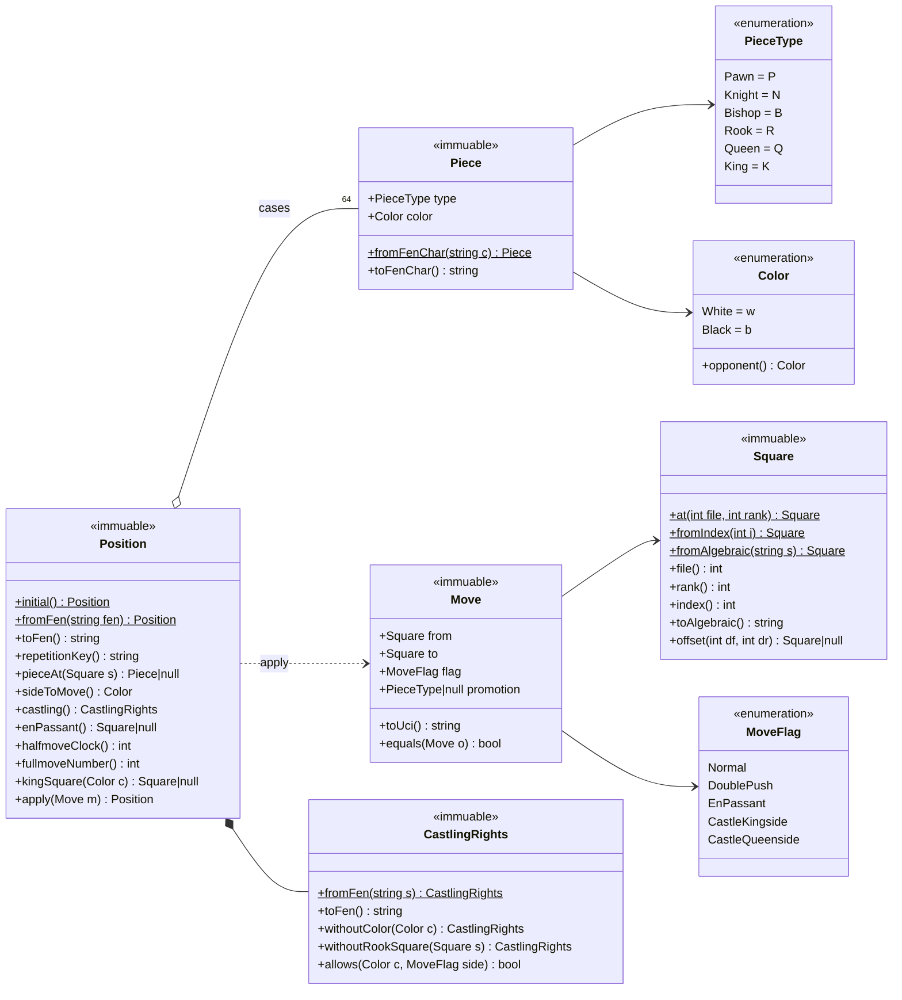
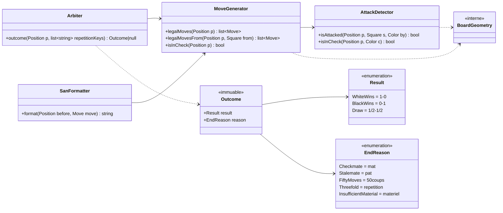
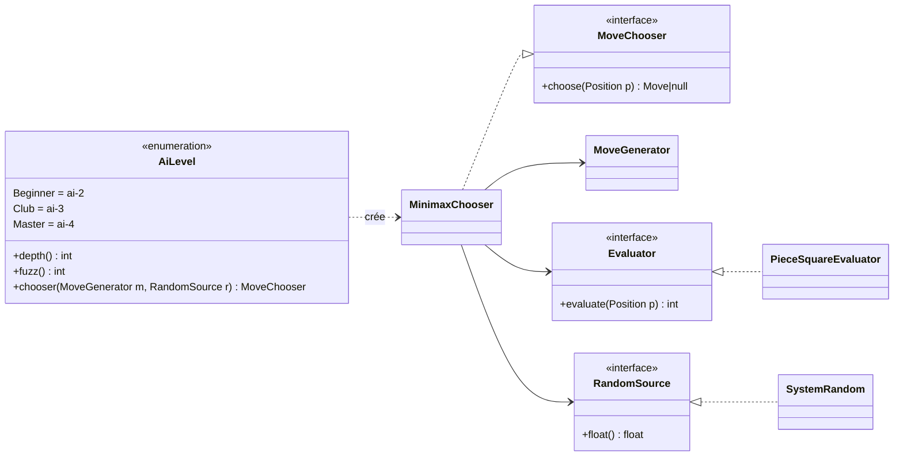

# Domaine échecs (`src/Chess/`)

[Architecture](README.md) › Domaine échecs

| Classe | Responsabilité |
|--------|----------------|
| `Square`, `Color`, `PieceType`, `Piece` | Valeurs de base : case (0 à 63), camp, type et pièce. |
| `Move`, `MoveFlag` | Un coup (origine, destination, drapeau, promotion) et son format UCI. |
| `CastlingRights` | Droits de roque. |
| `Position` | Position immuable : lecture et écriture FEN, application d'un coup, clé de répétition. |
| `AttackDetector` | Dit si une case est attaquée et si un roi est en échec. |
| `MoveGenerator` | Coups légaux d'une position (vérifié par perft). |
| `BoardGeometry` | Interne : directions des pièces, rayons et sauts précalculés pour chaque case. |
| `Arbiter`, `Outcome`, `Result`, `EndReason` | Fin de partie : mat, pat, règle des 50 coups, triple répétition, matériel insuffisant. |
| `SanFormatter` | Notation algébrique abrégée (SAN). |
| `Ai\MoveChooser`, `Ai\MinimaxChooser` | Choix d'un coup : minimax avec élagage alpha-bêta. |
| `Ai\Evaluator`, `Ai\PieceSquareEvaluator` | Note d'une position : matériel plus tables de cases, repris du moteur JavaScript d'origine. |
| `Ai\PieceValues` | Interne : valeur des pièces, partagée par l'évaluation et l'ordre des captures. |
| `Ai\RandomSource`, `Ai\SystemRandom` | Source d'aléa injectée et son implémentation système. |
| `Ai\AiLevel` | Les trois niveaux proposés (`ai-2`, `ai-3`, `ai-4` : débutant, club, maître) : profondeur et bruit. |

Règle de dépendance : `src/Chess` ne fait aucune entrée-sortie (ni base, ni
session, ni horloge) et ne dépend que de lui-même. L'aléa de l'IA entre par
`RandomSource`.

Diagrammes de classes, en trois parties (méthodes publiques, telles qu'elles
sont dans le code). Position et valeurs de base :

Règles : coups légaux, fin de partie, notation :

IA (`PieceValues`, interne, n'est pas dessiné) :

`Ai\` regroupe `MoveChooser`, `Evaluator`, `RandomSource`, `MinimaxChooser`,
`PieceSquareEvaluator`, `PieceValues`, `SystemRandom` et `AiLevel` ; les autres
classes sont dans `LeCercle\Chess`.

## Performances de l'IA

Temps du choix d'un coup sur la position Kiwipete, sans bruit, médiane de trois
mesures (2026-11-12, machine de développement 8 cœurs) :

| Niveau | Cible CI `test` (pcov chargé) | Proche d'Apache (pcov désactivé, opcache) |
|--------|------|------|
| Maître (profondeur 4) | 1,31 s | 0,53 s |
| Club (profondeur 3) | 0,18 s | 0,07 s |
| Débutant (profondeur 2) | 0,03 s | 0,01 s |

Avant ces optimisations, le niveau Maître prenait 17,7 à 20 s dans la cible
`test`.

Objectif : Maître en 3 s au plus dans la cible `test`. Le test lent
`testMasterLevelRespondsWithinBudget` échoue au-delà de 5 s, ce qui laisse une
marge aux machines de CI plus lentes. Calcul de la marge en production : la
position de référence la plus lente coûte 1,5 fois Kiwipete, la production n'a
pas pcov (÷ 2,4) et Apache a opcache (÷ 1,2), un serveur ancien ou partagé peut
être 3 fois plus lent : 1,31 s × 1,5 ÷ 2,9 × 3 ≈ 2 s, loin des 30 s de
`max_execution_time`.

Le plus gros gain vient d'une borne à la racine. Après le premier coup, chaque
coup racine est cherché avec une borne tirée du meilleur score bruité ; comme
`minimax` est « fail-soft », un coup écarté par la borne n'aurait pas été choisi
avec sa valeur exacte, quel que soit le bruit tiré. Les coups de référence de
`GoldenMovesTest` et les perft profonds vérifient que le coup choisi et les
coups légaux n'ont pas changé.

pcov instrumente chaque opcode dès qu'il est actif, même avec `--no-coverage` :
il multiplie le temps par 2,4 environ et empêche le JIT. Sous WampServer,
opcache, le JIT et Xdebug dépendent du `php.ini` de WampServer, hors du dépôt ;
Xdebug ralentit PHP plusieurs fois et doit rester désactivé sur la machine qui
sert l'application.

---

← [Organisation du code](organisation-du-code.md) · [Sommaire](README.md) · [Infrastructure et contrats d'API](infrastructure.md) →
