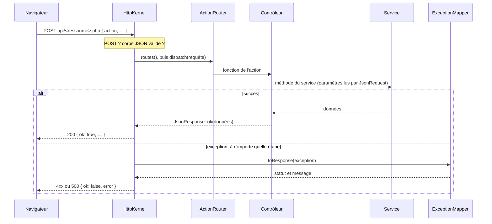

# Infrastructure et contrats d'API (`src/Shared/`, `src/Infra/`)

[Architecture](README.md) › Infrastructure et contrats d'API

`Shared` contient les ports dont plusieurs services ont besoin : l'horloge, la
session, les transactions et les exceptions métier. Placés dans `Game`, ils
rendraient `Chat`, `Tournament` et `User` dépendants de `Game` ; placés dans
`Infra`, la dépendance irait dans le mauvais sens. `Chess` et `Shared` ne
dépendent de rien ; `tests/Unit/ArchitectureTest.php` le vérifie. Il lit le
code sans les commentaires et refuse hors de `Infra` : PDO, les superglobales
`$_SESSION`, `$_COOKIE`, `$_GET`, `$_POST`, `$_SERVER`, `$_REQUEST` et `$_FILES`,
les fonctions `session_*()`, `header()`, `setcookie()`, `http_response_code()`,
`time()`, `date()`, `rand()`, `random_bytes()` et les autres fonctions de
`SourceScanner::FORBIDDEN` (horloge, hasard), ainsi que `new DateTimeImmutable()`
sans argument ou avec `'now'`. Les services (`Game`, `Chat`, `Tournament`,
`User`) ne dépendent que de `Chess`, de `Shared` et d'eux-mêmes.

| Classe | Responsabilité |
|--------|----------------|
| `Shared\Clock`, `Infra\SystemClock` | Heure courante, toujours en UTC. |
| `Shared\CurrentUser`, `Shared\SessionLogin`, `Infra\Session\PhpSession` | Utilisateur connecté (`$_SESSION['user_id']`, comme `api/auth.php`), connexion et déconnexion. La lecture ne garde pas le verrou de session. |
| `Shared\TransactionRunner`, `Infra\Db\PdoTransactionRunner` | Exécute un travail dans une transaction : annulée et exception relancée en cas d'échec ; un appel imbriqué rejoint la transaction ouverte. |
| `Shared\ValidationException`, `NotFoundException`, `ForbiddenException`, `ConflictException` | Erreurs métier dont le message, en français, est montré à l'utilisateur. |
| `Shared\Role`, `Member`, `Members`, `Infra\User\PdoMembers` | Rôle, compte (pseudo, suspendu, invité) et lecture des comptes par identifiant ou pseudo, sans casse. `findMany` résout plusieurs identifiants en une requête. |
| `Shared\Access` | Acteur de la requête : `viewer()` (null si personne n'est connecté), `member()` (403 si non connecté ou suspendu), `admin()` (403 si non administrateur). |
| `Shared\AdminJournal`, `Infra\Admin\PdoAdminJournal` | Une ligne dans `admin_log` par action d'administration, avec la phrase française affichée dans le journal. |
| `Shared\MemberRef` | Personne telle que l'API la renvoie, `{id, pseudo}` ; un compte supprimé devient `(compte supprimé)`. |
| `Shared\Millis` | Conversion entre `DateTimeImmutable` et millisecondes depuis l'époque Unix. |
| `Shared\TimeControl` | Cadence `{base, inc}` en secondes (base 1 à 10 800, incrément 0 à 180), commune aux parties et aux tournois. |
| `Infra\Db\SqlTime` | Format `DATETIME(3)` en UTC, dans les deux sens. |
| `Infra\Db\DbConfig` | Configuration de la base : variables d'environnement (`DB_HOST`…) d'abord, sinon `api/config.php`. Refuse les valeurs qui modifieraient le DSN. |
| `Infra\Db\PdoFactory` | Connexion PDO : exceptions, requêtes préparées natives, session MySQL en UTC. |
| `Infra\Db\Migration`, `MigrationDirectory`, `Migrator` | Lecture de `sql/migrations/` et application des migrations pas encore enregistrées (`php bin/migrate.php`). |
| `Infra\Http\JsonRequest`, `JsonResponse` | Corps JSON `{"action": …}` lu avec des types stricts ; réponses `{"ok": true, …}` ou `{"ok": false, "error": …}`. |
| `Infra\Http\ActionRouter`, `HttpKernel`, `ExceptionMapper`, `HttpException` | Routage par action, POST seulement, traduction des exceptions en statuts HTTP. |
| `Infra\Infrastructure` | Briques partagées de la racine de composition (PDO, horloge, session, transactions, comptes, accès, journal d'administration), créées à la demande. |

Chaque ressource a son point d'entrée `api/<ressource>.php`, qui construit à la
main le graphe de ses services ; `api/health.php` sert de modèle :

| Exception | Statut | Message renvoyé |
|-----------|--------|-----------------|
| `HttpException` (corps invalide, action inconnue, méthode) | 400 ou 405 | le sien |
| `ValidationException` | 422 | le sien |
| autre `InvalidArgumentException` | 422 | `Requête invalide.` |
| `NotFoundException` | 404 | le sien |
| `ForbiddenException` (dont `Connexion requise.`) | 403 | le sien |
| `ConflictException` | 409 | le sien |
| `TooManyRequestsException` (connexion) | 429 | le sien |
| toute autre exception | 500 | `Erreur interne du serveur.` ; classe, message, fichier et ligne vont au journal PHP |

Migrations : un fichier `sql/migrations/NNN-nom-en-kebab.sql` par changement,
appliqué une seule fois et enregistré dans `schema_migrations`. Plages :
001-099 socle, 100-199 parties, 200-299 discussions, 300-399 tournois,
400-499 utilisateurs, 500 et plus pour les changements transverses. Le DDL MySQL valide
implicitement, donc aucune transaction n'entoure une migration : une migration
en échec n'est pas enregistrée et arrête l'exécution. Les migrations sont la
seule source du schéma : `php bin/migrate.php`
crée toutes les tables d'une base vide. `002-journal-admin`
crée `admin_log`, le journal des actions d'administration ; `500-retrait-kv-store`
supprime `kv_store` et `stat_records`, `501-nettoyage-utilisateurs` les colonnes
`users.stats`, `legacy_salt` et `legacy_hash`.

Tests d'intégration : `tests/Integration/` utilise la base `le_cercle_test`
(créée par `docker/mysql/initdb/02-test-database.sh`) et refuse toute base dont
le nom ne finit pas par `_test`, car chaque test vide les tables avant de
s'exécuter.

Racine web : Apache sert `public/` et, sous l'alias `/api`, le
dossier `api/` (`docker/php/apache-site.conf` ; hôte virtuel équivalent pour
WampServer dans le [README](../../README.md#wampserver)). `src/`, `vendor/`, `sql/`, `tests/` et le reste
du dépôt ne sont pas sous la racine web ; `api/.htaccess` répond 404 pour
`api/config*.php`. `tests/http/smoke.sh` le vérifie.

# Contrats communs des API

Toutes les ressources suivent les mêmes règles.

1. Un point d'entrée par ressource : `api/games.php`, `rooms.php`,
   `direct-messages.php`, `game-comments.php`, `tournaments.php`, `auth.php`,
   `admin.php`. Le
   fichier construit le graphe d'objets et passe `(new <Ressource>Controller(...))->routes()`
   à `HttpKernel::serve`. Le contrôleur est dans
   `src/Infra/Http/Api/<Ressource>Controller.php` : il associe chaque action à
   une seule méthode de service, lit les paramètres avec `JsonRequest` et
   enveloppe le résultat avec `JsonResponse::ok`. Son test passe par
   `HttpKernel::handle('POST', $json, fn () => $controller->routes())` : le
   contrat JSON se vérifie sans Apache.
2. Le service retrouve l'acteur lui-même avec `Access` ; le contrôleur ne
   transmet jamais d'identifiant d'utilisateur. Les services reçoivent des types
   primitifs et valident leurs entrées (`ValidationException`, 422, message en
   français).
3. Clés JSON en anglais, en camelCase. Les valeurs d'énumération sont celles
   de l'interface : `'1-0'`, `'mat'`, `'inscriptions'`, `'round-robin'`,
   `'w'`/`'b'`.
4. Instants en millisecondes depuis l'époque Unix, en UTC, dans des clés qui
   finissent par `At` (`createdAt`). Durées en millisecondes (`whiteMs`).
   Cadences en secondes : `{"base": 300, "inc": 2}`
   ou `null`.
5. Personnes : `{"id": "u…", "pseudo": "…"}` construit avec `MemberRef` ;
   `null` quand il n'y a personne (place libre, exempt, système).
6. Identifiants : `u` + 12 caractères hexadécimaux pour les utilisateurs, `g` + 12 pour les parties, `r` + 12 ou `general` pour les
   salons, `t` + 12 pour les tournois, entiers pour les messages. Les dépôts PDO
   les génèrent.
7. Erreurs :

   | Situation | Statut | `error` |
   |-----------|--------|---------|
   | non connecté | 403 | `Connexion requise.` |
   | compte suspendu | 403 | `Compte suspendu par l’administration.` |
   | action d'administration par un non-administrateur | 403 | `Action réservée aux administrateurs.` |
   | identifiant inconnu, ou ressource privée d'un autre | 404 | `<Ressource> introuvable.` |
   | paramètre JSON d'un mauvais type | 422 | `Paramètre « x » manquant ou invalide.` (produit par `JsonRequest`) |
   | validation métier | 422 | message du service |
   | conflit d'état (pas votre tour, nom pris, mauvais statut…) | 409 | message du service |
   | corps mal formé, action inconnue, méthode autre que POST | 400 ou 405 | produit par le noyau |

8. Un visiteur anonyme lit l'état public : parties en ligne et salon d'attente,
   salons et leurs messages, commentaires de partie, tournois, présence, `me`.
   Toute écriture exige `Access::member()` ; une écriture d'administration exige
   `Access::admin()` et appelle `AdminJournal::record()`.
9. Les listes que le front interroge toutes les 2,5 à 8 s coûtent un nombre borné
   de requêtes, jamais une par ligne ; les personnes se résolvent avec un seul
   appel à `Members::findMany()`.

PHPStan analyse tout `api/` et PHP-CS-Fixer tous les `api/*.php`, sauf
`config*.php` : un nouveau point d'entrée est contrôlé sans configuration. De même, chaque fichier
`tests/http/smoke.d/NNN-nom.sh` est chargé par `tests/http/smoke.sh` après les
contrôles intégrés et partage son compteur d'échecs. Il dispose de `api`,
`expect_api`, `new_session` et `register_user` (voir `tests/http/smoke.d/README.md`).

---

← [Domaine échecs](echecs.md) · [Sommaire](README.md) · [Parties](parties.md) →
