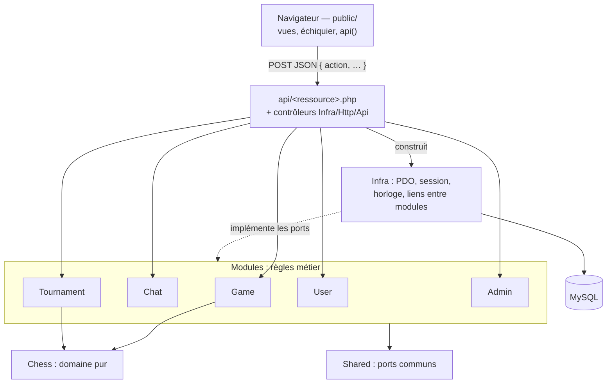
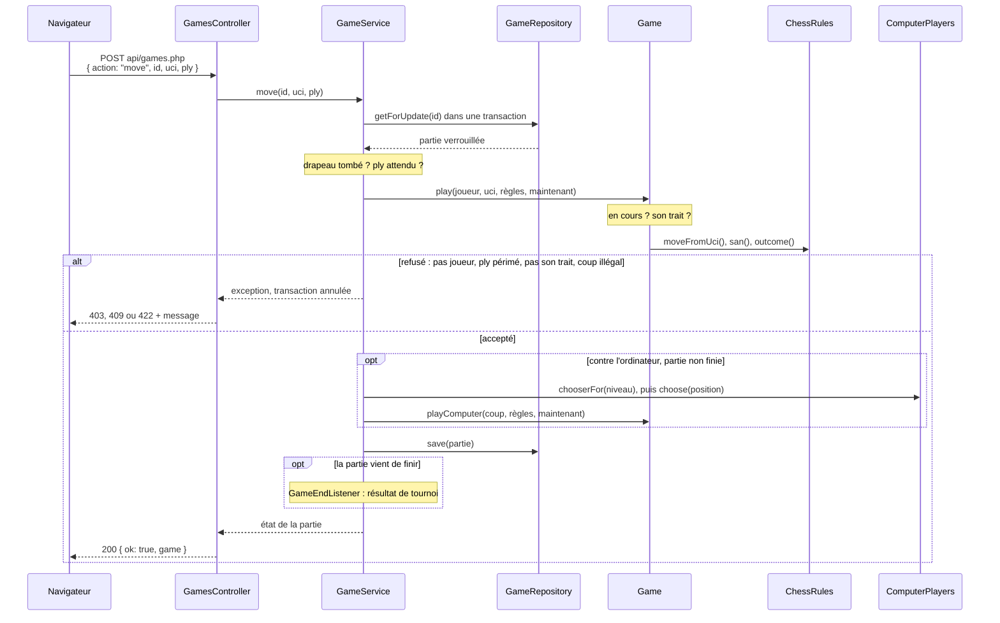

# Organisation du code

[Architecture](README.md) › Organisation du code

```
public/        racine web : index.html, css/, js/ (affichage seulement)
api/           points d'entrée PHP, servis sous /api : un fichier par ressource
src/
  Chess/       domaine pur : position, coups légaux, SAN, fin de partie, IA
  Game/        parties : création, coups, pendule, ordinateur, nulle, PGN
  Chat/        salons, messages privés, commentaires de partie
  Tournament/  appariements, classements, cycle de vie d'un tournoi
  User/        comptes, connexion, invités, présence, administration des comptes
  Admin/       journal et tableau de bord (lecture)
  Shared/      ports communs : horloge, session, transactions, exceptions, accès
  Infra/       implémentations : PDO, HTTP, session PHP, horloge système, liens
sql/migrations numérotées, seule source du schéma (php bin/migrate.php)
bin/           migrate.php
tests/         Unit/, Integration/ (MySQL), http/ (contrôle HTTP), front/
docker/        image PHP/Apache, configuration Apache, pile du test de fumée
```



Jouer un coup (partie locale, contre l'ordinateur ou en ligne) :



## Règles de dépendance

- `Chess` ne dépend de rien.
- Un module (`Game`, `Chat`, `Tournament`, `User`, `Admin`) ne référence que
  `Chess`, `Shared` et lui-même ; `tests/Unit/ArchitectureTest` le vérifie. Il
  n'appelle jamais directement PDO, `$_SESSION`, `time()` ou `random_int()` :
  il passe par des ports (`Clock`, `RandomSource`, `*Repository`…).
- `Infra` implémente ces ports. Quand deux modules doivent coopérer (une partie
  de tournoi qui se termine), c'est un adaptateur d'`Infra`
  (`Link/GameTournamentServices`) qui implémente le port de l'un en appelant
  l'autre : `Game` et `Tournament` ne se connaissent pas.
- `api/<ressource>.php` construit le graphe d'objets et confie la requête à un
  contrôleur (`Infra/Http/Api`), qui appelle une méthode de service par action.

Ce découpage est ce qui rend les règles testables sans base ni serveur web :
chaque service se teste avec des doublures en mémoire (`tests/Support/`), et
seuls les dépôts PDO ont besoin de MySQL.

## Navigateur (`public/`)

HTML, CSS et JavaScript sans framework ni dépendance npm, en scripts classiques
chargés dans l'ordre fixé par `index.html` : un fichier ne voit que ce que
déclarent les fichiers chargés avant lui.

- `js/core/` : utilitaires (`$`, `esc`), client d'API (`api.js`), échiquier
  piloté par le serveur (`server-board.js`), lecture FEN (`fen.js`), état
  affiché (`game-state.js` : pendule, état le plus récent, textes de fin),
  navigation, compte, présence, affichage des tournois.
- `js/views/` : une vue par fichier (accueil, jeu local, partie en ligne, salon,
  messages, tournois, administration).
- `js/main.js` : démarrage.

Le « temps réel » est un polling : salon d'attente 5 s, partie en ligne 2,5 s,
salon 3 s, messages privés 8 s (3 s pour la conversation ouverte), tournois
6 s, présence 25 s. Entre deux réponses, la pendule affichée décompte à partir
des valeurs du serveur ; à zéro, le navigateur relit la partie et le serveur
constate la chute du drapeau. Une réponse en retard ne fait jamais reculer
l'échiquier (`newer()`).

Les seules fonctions de calcul du navigateur (`fen.js`, `game-state.js`) sont
testées par `node tests/front/unit/run.mjs`.

---

← [Cas d'utilisation](cas-d-utilisation.md) · [Sommaire](README.md) · [Domaine échecs](echecs.md) →
