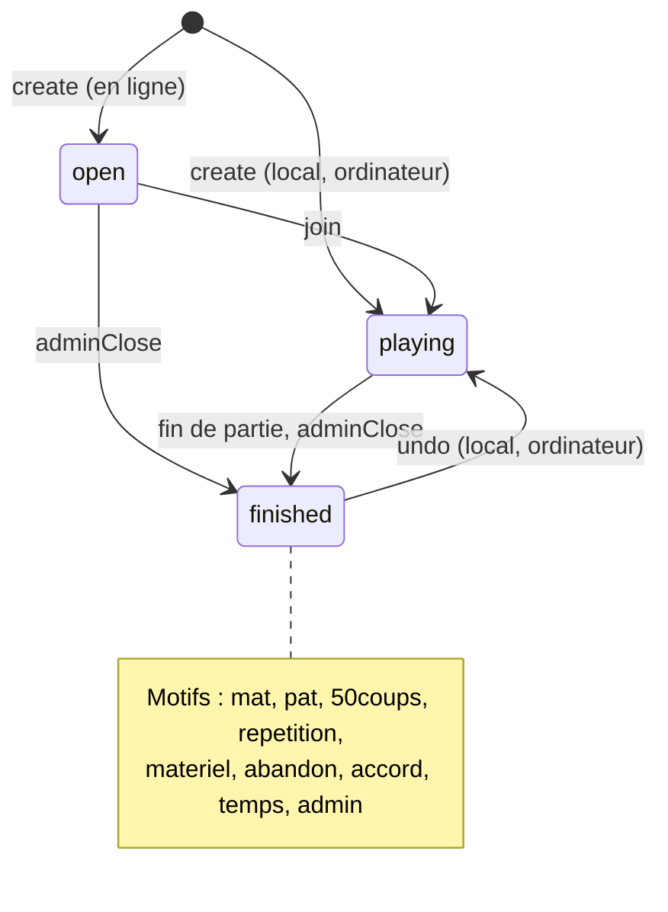

# Parties (`src/Game/`)

[Architecture](README.md) › Parties

`GameService` porte toutes les règles d'une partie : création, rejoindre, coups,
réponse de l'ordinateur, pendule, abandon, nulle, annulation de coup et PGN. Le
navigateur n'envoie que des intentions. Le service n'utilise que `Chess`,
`Shared` et son propre dossier ; le dépôt PDO et le contrôleur sont dans `Infra`,
branchés par `api/games.php`.

| Classe | Rôle |
|--------|------|
| `GameService` | Cas d'usage ; chaque écriture verrouille la partie (`getForUpdate`) dans une transaction. |
| `Game` | Agrégat : sièges, coups joués, pendule, fin de partie. La position se déduit des coups. |
| `GameSnapshot`, `PlayedMove` | Ce que le dépôt stocke : la partie et ses coups (UCI, SAN, temps restants, instant). |
| `GameClock` | Pendule calculée sur l'heure du serveur. |
| `GameMode`, `GameStatus`, `FinishReason` | Valeurs stockées : mode, statut, motif de fin. |
| `ChessRules` | Façade du domaine échecs : coups légaux, SAN, fin de partie. |
| `ComputerPlayers`, `MinimaxComputerPlayers` | Adversaire ordinateur d'un niveau donné (le minimax de `src/Chess/Ai`). |
| `GameRepository` | Port de stockage, implémenté par `Infra\Game\PdoGameRepository`. |
| `GameViews`, `GameSummary` | JSON d'une partie et des listes ; un seul `Members::findMany()` par réponse. |
| `PgnWriter` | Export PGN. |
| `Infra\Http\Api\GamesController` | Contrat HTTP : une action, une méthode du service. |

## États

## Pendule

- L'heure de référence est celle du serveur. `clock` donne les temps restants à
  l'instant `serverNow` ; le front décompte localement jusqu'au prochain
  polling.
- La pendule part au `join` d'une partie en ligne, au premier coup d'une partie
  locale ou contre l'ordinateur.
- Après un coup, le joueur reçoit l'incrément si sa pendule tournait ; celle de
  l'adversaire part de l'instant du coup.
- La chute du drapeau est constatée à la lecture ou à l'écriture suivante :
  `get` l'enregistre (sous verrou), et un coup joué après la chute n'est pas
  joué, la partie revient terminée (`temps`).
- Contre l'ordinateur, son temps de réflexion est décompté de sa pendule.

## API (`api/games.php`)

Toutes les actions sont des `POST` JSON `{ "action": "…", … }`. Une autre action
répond 400 « Action inconnue. » ; un paramètre absent ou mal typé, 422
« Paramètre « x » manquant ou invalide. ».

| Action | Paramètres | Accès | Réponse | Erreurs |
|--------|------------|-------|---------|---------|
| `create` | `mode`, `level` (ordinateur), `tc` (`{ base, inc }` en secondes ou `null`), `color` (en ligne : `w`, `b`, `random`) | compte | `{ game }` : `playing` (local, ordinateur) ou `open` (en ligne) | 403 ; 422 mode, niveau, couleur ou cadence |
| `join` | `id` | compte | `{ game }` `playing` ; un joueur de la partie la reçoit telle quelle | 404 ; 409 « Cette partie a déjà commencé. » |
| `get` | `id` | tous (local, ordinateur : propriétaire seulement) | `{ game }` | 404 « Partie introuvable. » |
| `move` | `id`, `uci`, `ply` (nombre de coups connus du client) | joueur au trait | `{ game }`, réponse de l'ordinateur comprise | 404 ; 403 ; 409 pas en cours, pas ton tour, « La partie a avancé : recharge-la. » ; 422 « Coup illégal. » |
| `resign` | `id` | joueur en ligne | `{ game }` terminée, `abandon` | 404 ; 403 ; 409 |
| `offerDraw` | `id` | joueur en ligne | `{ game }` avec `drawOffer` | 404 ; 403 ; 409 |
| `acceptDraw` | `id` | joueur en ligne face à une offre | `{ game }` terminée `1/2-1/2`, `accord` | 404 ; 403 ; 409 |
| `undo` | `id` | propriétaire (local, ordinateur) | `{ game }` un demi-coup en arrière (ordinateur : jusqu'au trait du propriétaire), même après la fin | 404 ; 409 |
| `list` | | tous | `{ games }` : parties en ligne ouvertes ou en cours, et terminées depuis 2 h ; 30 au plus, les plus récentes d'abord | |
| `mine` | | compte | `{ games }` : parties non terminées du visiteur, 10 au plus | 403 |
| `pgn` | `id` | comme `get` | `{ filename, pgn }` | 404 |

Une partie locale ou contre l'ordinateur n'existe que pour son propriétaire :
tout autre visiteur reçoit 404.

Administration, réservée aux administrateurs et journalisée dans la
même transaction :

| Action | Paramètres | Réponse | Phrase du journal |
|--------|------------|---------|-------------------|
| `adminList` | | `{ games }` : toutes les parties, tous modes, 200 au plus | |
| `adminClose` | `id`, `result?` (`1/2-1/2` par défaut) | `{ game }` terminée, `reason: "admin"` ; 409 si déjà terminée | `Clôture administrative de la partie <id>` |
| `adminDelete` | `id` | `{}` ; coups et commentaires supprimés, l'appariement de tournoi garde son résultat et perd son lien | `Suppression de la partie <id>` |
| `purge` | | `{ deleted }` : parties terminées supprimées | `Purge de <n> partie(s) terminée(s)` |

Partie de tournoi : `GameService::createForPairing()` crée une partie en ligne
déjà en cours, les deux sièges pris ; la pendule ne part qu'au premier coup des
Blancs. Toute écriture qui termine une partie (coup, abandon, nulle acceptée,
chute du drapeau, clôture administrative) prévient `GameEndListener` dans la
même transaction ; `Infra\Link\GameTournamentServices` relaie vers le tournoi.

Champs de `game` :

| Champ | Sens |
|-------|------|
| `id`, `mode`, `status`, `level` | Identifiant (`g` + 12 hexadécimaux), `local`/`ai`/`online`, `open`/`playing`/`finished`, `ai-2` à `ai-4` ou `null`. |
| `white`, `black` | `{ id, pseudo }` ; local : le propriétaire des deux côtés ; ordinateur : `black` à `null` ; en ligne : `null` pour un siège libre. |
| `tc` | `{ base, inc }` en secondes, ou `null`. |
| `fen`, `turn` | Position et trait. |
| `moves`, `lastMove` | Coups en SAN (lettres anglaises, le front traduit) ; dernier coup `{ from, to }`. |
| `legalMoves` | Coups UCI du camp au trait, seulement si le visiteur peut le jouer ; sinon `[]`. |
| `inCheck`, `captured` | Échec au roi ; pièces prises par chaque camp (lettres FEN). |
| `clock` | `{ whiteMs, blackMs, running, serverNow }` ou `null` sans cadence. |
| `drawOffer` | Couleur qui propose la nulle, ou `null`. |
| `result`, `reason` | `1-0`, `0-1`, `1/2-1/2` ; `mat`, `pat`, `50coups`, `repetition`, `materiel`, `abandon`, `accord`, `temps`. |
| `yourColor` | Ce que le visiteur peut jouer : `w`, `b`, `both` (local) ou `null`. |
| `createdAt`, `updatedAt` | Instants en millisecondes. |

Les listes renvoient des résumés `{ id, mode, status, white, black, level, tc,
result, reason, updatedAt }`.

## Stockage

Migration `100-parties.sql` : `games` (une ligne par partie, pendule comprise)
et `game_moves` (un coup par ligne, avec ses temps restants ; clé étrangère
`ON DELETE CASCADE` vers `games`). Le dépôt recharge une partie en rejouant ses
coups ; `save()` n'écrit que les coups nouveaux et efface ceux qu'une annulation
a retirés. Chaque écriture verrouille la ligne de la partie (`SELECT … FOR
UPDATE`) jusqu'à la fin de la transaction.

---

← [Infrastructure et contrats d'API](infrastructure.md) · [Sommaire](README.md) · [Discussions](discussions.md) →
