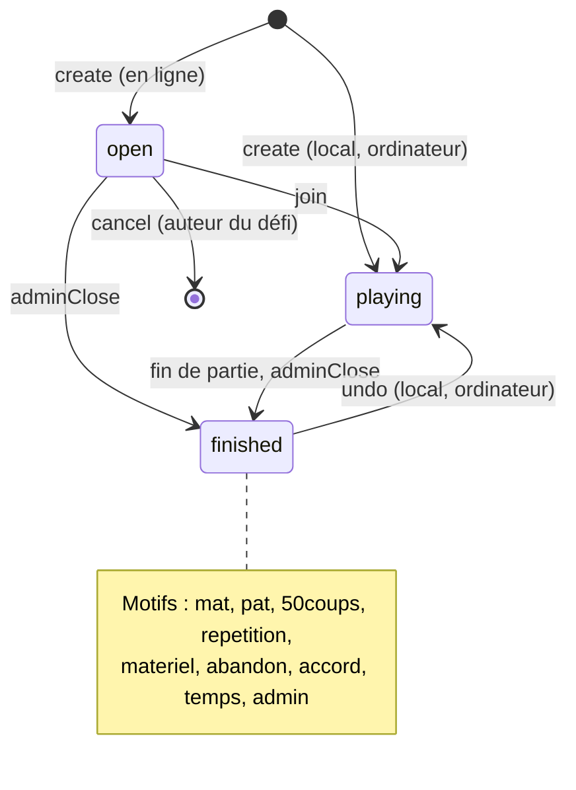

# Parties (`src/Game/`)

[Architecture](README.md) › Parties

`GameService` porte toutes les règles d'une partie : création, rejoindre, coups,
réponse de l'ordinateur, pendule, abandon, nulle, annulation de coup et PGN. Le
navigateur n'envoie que des intentions. Le service n'utilise que `Chess`,
`Shared` et son propre dossier ; le dépôt PDO et le contrôleur sont dans `Infra`,
branchés par `api/games.php`.

| Classe | Rôle |
|--------|------|
| `GameService` | Cas d'usage ; chaque écriture verrouille la partie (`getForUpdate`) dans une transaction. |
| `Game` | Agrégat : sièges, coups joués, pendule, fin de partie. La position se déduit des coups. |
| `GameSnapshot`, `PlayedMove` | Ce que le dépôt stocke : la partie et ses coups (UCI, SAN, temps restants, instant). |
| `GameClock` | Pendule calculée sur l'heure du serveur. |
| `GameMode`, `GameStatus`, `FinishReason` | Valeurs stockées : mode, statut, motif de fin. |
| `ChessRules` | Façade du domaine échecs : coups légaux, SAN, fin de partie. |
| `ComputerPlayers`, `MinimaxComputerPlayers` | Adversaire ordinateur d'un niveau donné (le minimax de `src/Chess/Ai`). |
| `GameRepository` | Port de stockage, implémenté par `Infra\Game\PdoGameRepository`. |
| `GameFrame` | État après un demi-coup donné (FEN, échec, dernier coup, prises, temps), pour la relecture ; `Game::frames()` les calcule sur une copie de la partie. |
| `GamePulse` | État léger d'une partie, lu sans ses coups (`GameRepository::pulse()`) : sa `version` et la chute éventuelle du drapeau. |
| `ResultArchive` | Port : garde le résultat d'une partie en ligne purgée (`Infra\Game\PdoResultArchive`, table `archived_stats`). |
| `GameViews`, `GameSummary` | JSON d'une partie et des listes ; un seul `Members::findMany()` par réponse. |
| `PgnWriter` | Export PGN. |
| `Infra\Http\Api\GamesController` | Contrat HTTP : une action, une méthode du service. |

## États

## Pendule

- L'heure de référence est celle du serveur. `clock` donne les temps restants à
  l'instant `serverNow` ; le front décompte localement jusqu'au prochain
  polling.
- La pendule part au `join` d'une partie en ligne, au premier coup d'une partie
  locale ou contre l'ordinateur.
- Après un coup, le joueur reçoit l'incrément si sa pendule tournait ; celle de
  l'adversaire part de l'instant du coup.
- La chute du drapeau est constatée à la lecture ou à l'écriture suivante :
  `get` l'enregistre (sous verrou), et un coup joué après la chute n'est pas
  joué, la partie revient terminée (`temps`).
- Contre l'ordinateur, son temps de réflexion est décompté de sa pendule.

## API (`api/games.php`)

Toutes les actions sont des `POST` JSON `{ "action": "…", … }`. Une autre action
répond 400 « Action inconnue. » ; un paramètre absent ou mal typé, 422
« Paramètre « x » manquant ou invalide. ».

| Action | Paramètres | Accès | Réponse | Erreurs |
|--------|------------|-------|---------|---------|
| `create` | `mode`, `level` (ordinateur), `tc` (`{ base, inc }` en secondes ou `null`), `color` (en ligne : `w`, `b`, `random`) | compte | `{ game }` : `playing` (local, ordinateur) ou `open` (en ligne) | 403 ; 422 mode, niveau, couleur ou cadence ; 429 au-delà du débit de création |
| `join` | `id` | compte | `{ game }` `playing` ; un joueur de la partie la reçoit telle quelle | 404 ; 409 « Cette partie a déjà commencé. » |
| `cancel` | `id` | auteur du défi | `{}` ; le défi et ses commentaires sont supprimés, rien n'est compté | 404 ; 403 « Seul l’auteur du défi peut l’annuler. » ; 409 « Seul un défi qui attend encore un adversaire peut être annulé. » |
| `get` | `id`, `known?` (la `version` affichée) | tous (local, ordinateur : propriétaire seulement) | `{ game }` ; `{ unchanged: true }` si `known` est la version courante | 404 « Partie introuvable. » |
| `move` | `id`, `uci`, `ply` (nombre de coups connus du client) | joueur au trait | `{ game }`, réponse de l'ordinateur comprise | 404 ; 403 ; 409 pas en cours, pas ton tour, « La partie a avancé : recharge-la. » ; 422 « Coup illégal. » |
| `resign` | `id` | joueur en ligne | `{ game }` terminée, `abandon` | 404 ; 403 ; 409 |
| `offerDraw` | `id` | joueur en ligne | `{ game }` avec `drawOffer` | 404 ; 403 ; 409 |
| `acceptDraw` | `id` | joueur en ligne face à une offre | `{ game }` terminée `1/2-1/2`, `accord` | 404 ; 403 ; 409 |
| `history` | `offset?` (0 par défaut, 0 à 10 000) | compte | `{ games, more }` : parties en ligne terminées du visiteur (tournois compris), 20 par page, les plus récentes d'abord ; `more` dit s'il en reste | 403 ; 422 « Page d’historique invalide. » |
| `replay` | `id` | comme `get` | `{ replay: { id, frames } }` : une entrée par demi-coup, la position de départ en tête | 404 |
| `undo` | `id` | propriétaire (local, ordinateur) | `{ game }` un demi-coup en arrière (ordinateur : jusqu'au trait du propriétaire), même après la fin | 404 ; 409 |
| `list` | | tous | `{ games }` : parties en ligne ouvertes ou en cours, et terminées depuis 2 h ; 30 au plus, les plus récentes d'abord | |
| `mine` | | compte | `{ games }` : parties non terminées du visiteur, 10 au plus | 403 |
| `pgn` | `id` | comme `get` | `{ filename, pgn }` | 404 |

Une partie locale ou contre l'ordinateur n'existe que pour son propriétaire :
tout autre visiteur reçoit 404.

Annulation d'un défi : `cancel` verrouille la partie, vérifie qu'elle attend
encore un adversaire et que le demandeur en est l'auteur
(`Game::assertCancellableBy()`), puis la supprime avec ses commentaires. Un
adversaire qui rejoint au même instant passe avant ou après, jamais les deux :
si `join` gagne, l'annulation répond 409 et la partie continue. L'annulation
n'est pas journalisée (ce n'est pas une action d'administration) et ne rend
pas de place dans la limite de 5 défis par 10 minutes, qui compte les
créations.

Historique et relecture : `history` liste les parties en ligne terminées du
compte connecté, les parties de tournoi comprises (les parties locales et
contre l'ordinateur n'y figurent pas). Le service en demande une de plus que
la page pour savoir s'il en reste, sans requête de comptage. `replay` renvoie
une entrée par demi-coup, `frames[0]` étant la position de départ :
`{ fen, inCheck, lastMove, captured, clock }`, avec `clock` à
`{ whiteMs, blackMs }` (temps restants après le coup) ou `null` sans cadence.
Les positions sont calculées par le serveur en rejouant les coups stockés :
le navigateur n'applique aucune règle, même pour revenir en arrière. La
relecture d'une partie en cours est permise (mêmes droits que `get`), mais
le front ne la propose que pour une partie terminée.

Relecture périodique : le front relit une partie en ligne toutes les 2,5 s en
envoyant dans `known` la `version` qu'il affiche. `GameService::getIfChanged()`
lit alors seulement le `GamePulse` (une ligne de `games` et le nombre de coups)
et répond `unchanged` si la version est la même : la partie n'est ni rechargée
ni rejouée. Deux cas forcent la lecture entière : une version différente, et un
drapeau tombé depuis la dernière écriture, pour que la fin au temps soit
enregistrée. La version réunit l'instant de dernière écriture, le nombre de
coups, le statut et la proposition de nulle ; elle ne dépend pas du visiteur,
donc le front ne la renvoie que pour le compte qui a reçu l'état affiché.

Débit de création, par compte et par tranche de 10 minutes : 5 défis en ligne
(429 « Tu as créé trop de défis. Patiente quelques minutes. ») et, comptées à
part, 30 parties locales ou contre l'ordinateur (429 « Tu crées des parties
trop vite. Patiente quelques minutes. »). Une demande invalide ne compte pas ;
les parties de tournoi ne sont pas limitées. Le décompte passe par le port
`Shared\Throttle` ([Infrastructure](infrastructure.md)).

Administration, réservée aux administrateurs et journalisée dans la
même transaction :

| Action | Paramètres | Réponse | Phrase du journal |
|--------|------------|---------|-------------------|
| `adminList` | | `{ games }` : toutes les parties, tous modes, 200 au plus | |
| `adminClose` | `id`, `result?` (`1/2-1/2` par défaut) | `{ game }` terminée, `reason: "admin"` ; 409 si déjà terminée | `Clôture administrative de la partie <id>` |
| `adminDelete` | `id` | `{}` ; coups et commentaires supprimés, l'appariement de tournoi garde son résultat et perd son lien ; la partie ne compte plus dans les statistiques | `Suppression de la partie <id>` |
| `purge` | | `{ deleted }` : parties terminées supprimées ; les statistiques des joueurs sont conservées | `Purge de <n> partie(s) terminée(s)` |

La purge sert à garder la base petite, pas à annuler des parties : dans la même
transaction, elle verrouille les parties terminées, confie le résultat de
chaque partie en ligne à `ResultArchive`, puis les supprime. `adminDelete`
n'archive rien : supprimer une partie précise la retire aussi des statistiques.

Partie de tournoi : `GameService::createForPairing()` crée une partie en ligne
déjà en cours, les deux sièges pris ; la pendule ne part qu'au premier coup des
Blancs. Toute écriture qui termine une partie (coup, abandon, nulle acceptée,
chute du drapeau, clôture administrative) prévient `GameEndListener` dans la
même transaction ; `Infra\Link\GameTournamentServices` relaie vers le tournoi.

Champs de `game` :

| Champ | Sens |
|-------|------|
| `id`, `mode`, `status`, `level` | Identifiant (`g` + 12 hexadécimaux), `local`/`ai`/`online`, `open`/`playing`/`finished`, `ai-2` à `ai-4` ou `null`. |
| `white`, `black` | `{ id, pseudo }` ; local : le propriétaire des deux côtés ; ordinateur : `black` à `null` ; en ligne : `null` pour un siège libre. |
| `tc` | `{ base, inc }` en secondes, ou `null`. |
| `fen`, `turn` | Position et trait. |
| `moves`, `lastMove` | Coups en SAN (lettres anglaises, le front traduit) ; dernier coup `{ from, to }`. |
| `legalMoves` | Coups UCI du camp au trait, seulement si le visiteur peut le jouer ; sinon `[]`. |
| `inCheck`, `captured` | Échec au roi ; pièces prises par chaque camp (lettres FEN). |
| `clock` | `{ whiteMs, blackMs, running, serverNow }` ou `null` sans cadence. |
| `drawOffer` | Couleur qui propose la nulle, ou `null`. |
| `result`, `reason` | `1-0`, `0-1`, `1/2-1/2` ; `mat`, `pat`, `50coups`, `repetition`, `materiel`, `abandon`, `accord`, `temps`. |
| `yourColor` | Ce que le visiteur peut jouer : `w`, `b`, `both` (local) ou `null`. |
| `createdAt`, `updatedAt` | Instants en millisecondes. |
| `version` | Jeton d'état, opaque pour le navigateur : il change à chaque écriture de la partie. À renvoyer dans `known` à la relecture suivante. |

Les listes renvoient des résumés `{ id, mode, status, white, black, level, tc,
result, reason, updatedAt }`.

## Stockage

Migration `100-parties.sql` : `games` (une ligne par partie, pendule comprise)
et `game_moves` (un coup par ligne, avec ses temps restants ; clé étrangère
`ON DELETE CASCADE` vers `games`). Le dépôt recharge une partie en rejouant ses
coups ; `save()` n'écrit que les coups nouveaux et efface ceux qu'une annulation
a retirés. Chaque écriture verrouille la ligne de la partie (`SELECT … FOR
UPDATE`) jusqu'à la fin de la transaction.

---

← [Infrastructure et contrats d'API](infrastructure.md) · [Sommaire](README.md) · [Discussions](discussions.md) →
