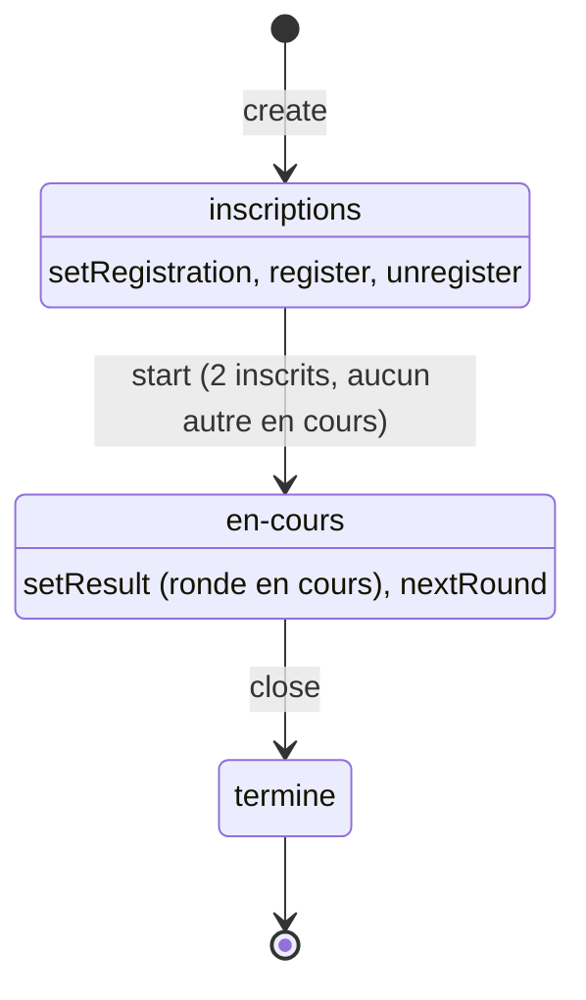

# Tournois (`src/Tournament/`)

[Architecture](README.md) › Tournois

`TournamentService` porte les inscriptions, l'administration et les lectures ;
il n'utilise que `Shared`, `Chess\Result` et son propre dossier. L'agrégat
`Tournament` garde l'état et ses garde-fous. Le dépôt PDO est
`src/Infra/Tournament/PdoTournamentRepository.php`, le contrôleur
`src/Infra/Http/Api/TournamentsController.php`, branché par
`api/tournaments.php`. Les algorithmes reprennent ceux du
prototype JavaScript, à l'identique.

## Appariements

- **Toutes rondes** (`RoundRobin`) : méthode du cercle. Avec un nombre impair de
  joueurs, un exempt complète la liste ; le joueur apparié à l'exempt ne joue
  pas cette ronde. Toutes les rondes sont générées au lancement.
- **Élimination directe** (`Elimination`) : les joueurs, dans l'ordre
  d'inscription, sont les têtes de série, placées dans l'ordre classique du
  tableau (1 contre 16, 8 contre 9…). Des exempts complètent jusqu'à la puissance
  de 2 supérieure et donnent une victoire immédiate. Chaque ronde suivante
  apparie les vainqueurs de la précédente.
- **Suisse** (`Swiss`) : à chaque ronde, les joueurs sont pris dans l'ordre du
  classement et chacun affronte le premier suivant qu'il n'a pas encore
  rencontré. Avec un nombre impair, le bye (un point) va au joueur le moins bien
  classé qui n'en a pas encore eu. Le nombre de rondes est fixé à la création
  (2 à 15, 5 par défaut).

## Classement

Victoire 1, nulle ½, défaite 0 ; un bye compte comme une victoire. Le classement
trie par points, puis par nombre de victoires, puis par pseudo en minuscules
(`strcmp` : les pseudos accentués se classent après les autres). Il n'est pas stocké : il se calcule à chaque
lecture.

## États

- Un seul tournoi `en-cours` à la fois (409 « Un autre tournoi est déjà en cours
  (un seul à la fois). »).
- Seuls les résultats de la ronde en cours se corrigent ; les rondes passées et
  les tournois terminés sont figés (409).
- `nextRound` refuse une ronde incomplète (409), sauf en toutes rondes avec
  `force: true`. En élimination, il refuse quand il ne reste qu'un joueur ; en
  suisse, quand le nombre de rondes prévu est atteint.
- Les comptes invités ne peuvent ni s'inscrire ni se désinscrire (403 « Un
  compte invité ne peut pas s'inscrire à un tournoi. »).
- Les noms sont uniques (409 « Ce nom de tournoi est déjà pris. »). Sous MySQL la
  comparaison ignore la casse et les accents ; deux créations simultanées sont
  arrêtées par l'index unique avec la même réponse.

## API (`api/tournaments.php`)

Toutes les actions sont des `POST` JSON `{ "action": "…", … }` ; les erreurs
suivent le [tableau des contrats communs](infrastructure.md#contrats-communs-des-api).

| Action | Paramètres | Accès | Réponse |
|--------|------------|-------|---------|
| `list` | | tous | `{ tournaments }` : `{ id, name, format, tc, status, playerCount, startedAt }`, par statut puis du plus récent au plus ancien |
| `get` | `id` | tous | `{ tournament }` |
| `register`, `unregister` | `id` | compte inscrit | `{ tournament }` |
| `create` | `name`, `description?`, `format`, `tc` (`{ base, inc }` ou `null`), `rounds?` (suisse) | admin | `{ tournament }` |
| `setRegistration` | `id`, `open` | admin | `{ tournament }` |
| `start` | `id` | admin | `{ tournament }` |
| `setResult` | `id`, `round`, `board`, `result` (`1-0`, `0-1`, `1/2-1/2` ou `null` pour effacer) | admin | `{ tournament }` |
| `nextRound` | `id`, `force` | admin | `{ tournament }` |
| `close` | `id` | admin | `{ tournament }` |
| `delete` | `id` | admin | `{}` |

Un tournoi est `{ id, name, description, format, tc, status, registrationOpen,
plannedRounds, currentRound, canAdvance, players, rounds, standings, registered,
myPairing, createdBy, createdAt, startedAt, finishedAt }`. Les joueurs sont
`{ id, pseudo }`, un compte supprimé apparaît comme « (compte supprimé) ».
`registered` et `myPairing` concernent le visiteur ; `myPairing` n'est rempli que
pendant `en-cours`. Pour les non-administrateurs, les rondes futures d'un toutes
rondes en cours sont masquées. Chaque réponse charge les comptes en un seul
`Members::findMany()`.

Chaque écriture d'administration est inscrite au journal (`admin_log`) dans la
même transaction que la modification :

| Action | Phrase du journal |
|--------|-------------------|
| `create` | `Création du tournoi « X »` |
| `setRegistration` | `Tournoi « X » : inscriptions ouvertes` ou `fermées` |
| `start` | `Lancement du tournoi « X » (n joueurs)` |
| `setResult` | `Tournoi « X » : R1 alice–bob = 1-0` (ou `= effacé`) |
| `nextRound` | `Tournoi « X » : passage à la ronde n` |
| `close` | `Clôture du tournoi « X »` |
| `delete` | `Suppression du tournoi « X »` |

## Tables

Migration `300-tournois.sql` :

| Table | Contenu |
|-------|---------|
| `tournaments` | Un tournoi. Nom unique (`uniq_tournaments_name`), index sur le statut. |
| `tournament_players` | Inscrits, avec `seq` = ordre d'inscription (têtes de série). |
| `tournament_pairings` | Appariements par ronde et échiquier ; `white_id` ou `black_id` à `NULL` pour un exempt ; `game_id` désigne la partie de la rencontre (`NULL` pour un exempt). |

Les deux tables filles ont une clé étrangère `ON DELETE CASCADE` vers
`tournaments`.

## Parties des appariements

`start` et `nextRound` créent une partie par rencontre de la nouvelle ronde
(port `PairingGames`) ; un exempt n'a pas de partie. Quand une partie liée se
termine, son résultat s'inscrit sur l'appariement dans la même transaction,
quelle que soit sa ronde, sans entrée de journal. Un tournoi terminé ignore les
résultats tardifs. Le verrou des rondes passées ne vaut que pour la saisie
manuelle (`setResult`).

---

← [Utilisateurs](utilisateurs.md) · [Sommaire](README.md) · [Administration](administration.md) →
